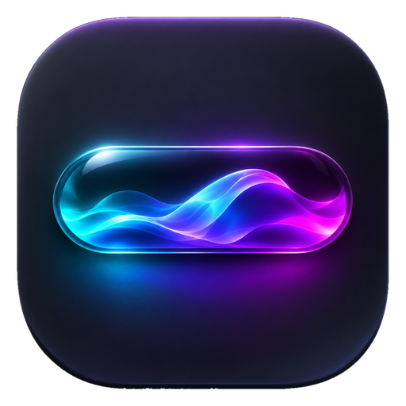
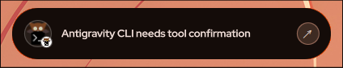
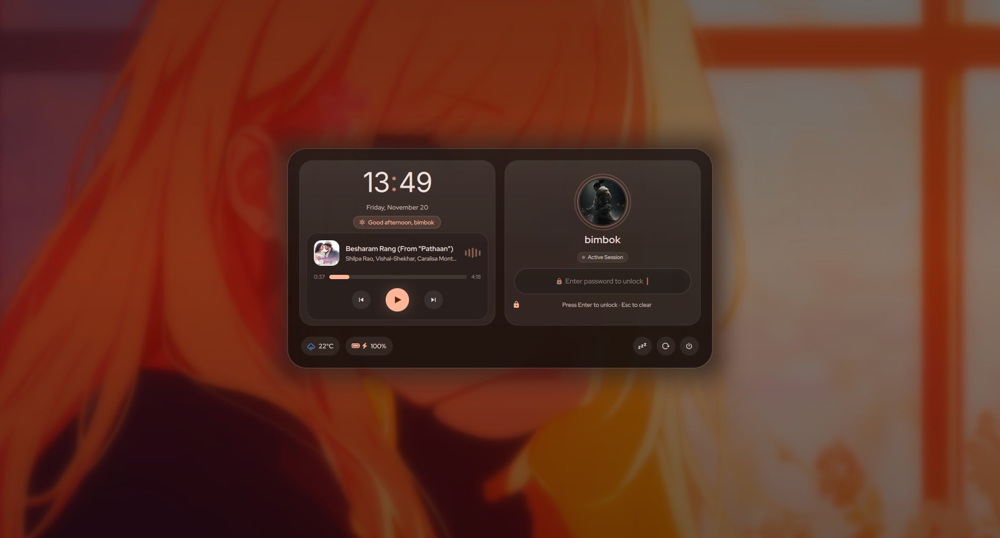
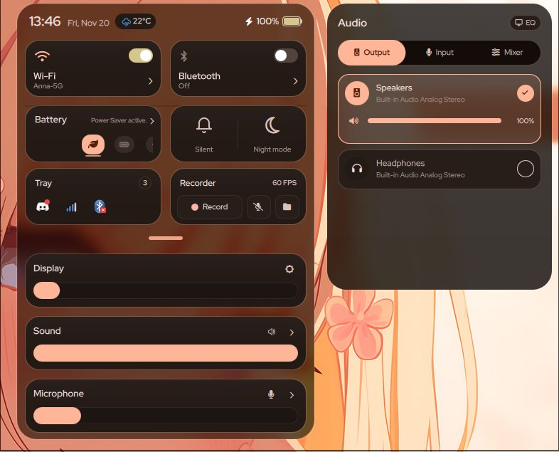
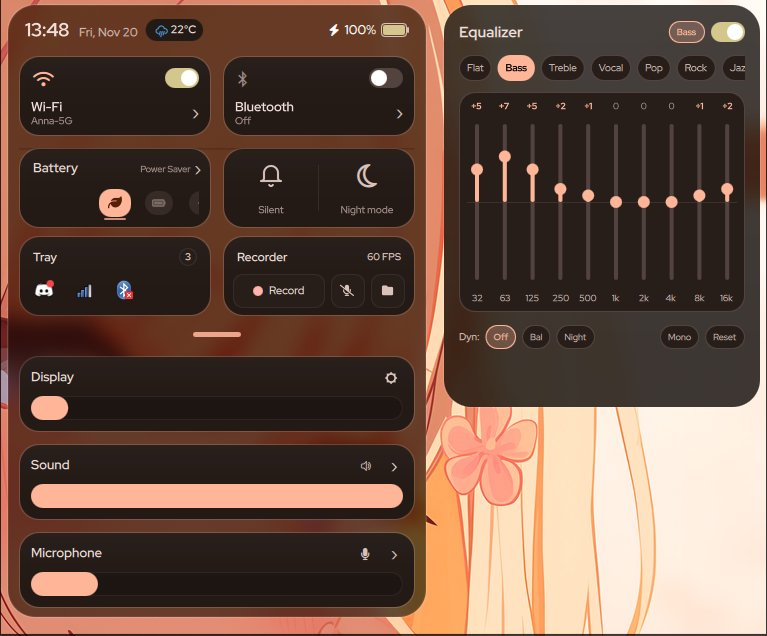
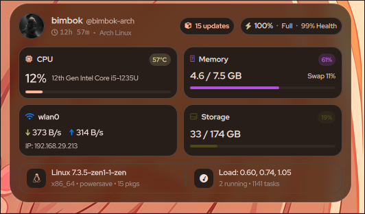

<p align="center">
  
</p>

<h1 align="center">Tide Island Extended</h1>

<p align="center">
  <b>An independently maintained, ultra-responsive dynamic island and control center for Hyprland and niri.</b>
</p>

<p align="center">
  <a href="https://github.com/Bimbok/Tide-island-extended/stargazers"></a>
  <a href="https://github.com/Bimbok/Tide-island-extended/issues"></a>
  <a href="https://github.com/enhaoswen/Tide-island"></a>
  
  
  
</p>

<p align="center">
  <a href="https://trendshift.io/repositories/361921?utm_source=trendshift-badge&amp;utm_medium=badge&amp;utm_campaign=badge-trendshift-361921" target="_blank" rel="noopener noreferrer"></a>
</p>

<p align="center">
  <a href="#preview">Preview</a>
  ·
  <a href="#key-highlights">Highlights</a>
  ·
  <a href="#performance">Performance</a>
  ·
  <a href="#quick-start">Quick Start</a>
  ·
  <a href="#documentation--wiki">Documentation</a>
  ·
  <a href="#common-commands">Commands</a>
  ·
  <a href="#acknowledgments">Credits</a>
</p>

---

## About

**Tide Island Extended** is a desktop widget and control center for modern Wayland compositors (**Hyprland** and **niri**), styled after the Dynamic Island concept.

When idle, it rests unobtrusively in your status bar or screen corner as a minimalist capsule pill or flush MacBook-style notch. When needed, it smoothly expands into an interactive panel for media playback, real-time synchronized lyrics, multi-audio device routing, a native 10-band DSP equalizer, hardware telemetry, battery conservation thresholds, screen recording, and system glance.

Built with **Quickshell**, **QML**, and **C++/Qt 6**, animations are hardware-accelerated and fluid while maintaining an exceptionally light resource footprint.

> [!NOTE]
> **Tide Island Extended** is an independently maintained fork of [Tide Island](https://github.com/enhaoswen/Tide-island) by [**@enhaoswen**](https://github.com/enhaoswen). While respecting upstream's core architectural foundation, this project maintains its own active development path with extended features, multi-distro packaging, and ongoing performance tuning.

---

## Preview

### Dynamic Island & Top Notch Capsules
<p align="center">
  
</p>

<table>
  <tr>
    <td width="33%" align="center">
      
    </td>
    <td width="33%" align="center">
      
    </td>
    <td width="33%" align="center">
      
    </td>
  </tr>
</table>

### Native Dynamic Island Lockscreen
<p align="center">
  
</p>

### Interactive Panels
<table>
  <tr>
    <td width="50%"></td>
    <td width="50%"></td>
  </tr>
  <tr>
    <td width="50%"></td>
    <td width="50%"></td>
  </tr>
  <tr>
    <td width="50%"></td>
    <td width="50%"></td>
  </tr>
  <tr>
    <td width="50%"></td>
    <td width="50%"></td>
  </tr>
  <tr>
    <td width="50%"></td>
    <td width="50%"></td>
  </tr>
</table>

### Configuration App
<p align="center">
  
</p>

---

## Key Highlights

* **Dynamic Island & MacBook-Style Top Notch**: Toggle between floating pill (`y: 12px`) and flush top notch (`y: 0px`) on the fly via `Super + Alt + N` or the Config App.
* **Native 10-Band DSP Audio Equalizer**: Dedicated low-latency C++ equalizer daemon (`tide-equalizer`) with SIMD power-of-two DSP FrameRing, 8 curated presets, stereo balance, dynamics modes, and zero-resource on-demand lifecycle (0% CPU / 0 MB RAM when disabled).
* **Multi-Device Simultaneous Audio Output ("Multi-Audio")**: Play audio across multiple physical outputs (e.g. Speakers + Bluetooth earbuds + USB DAC) at the same time with independent device volume sliders and automated PipeWire combined sinks.
* **Hardware Screen Recorder & Replay**: Powered by `gpu-screen-recorder` with Linux `pidfd` monitoring, mic audio capture, live Control Center banner elevation, and 10s/30s/60s instant replay buffers.
* **Battery Health & Conservation Mode**: Laptop charge capping (Lenovo IdeaPad 80% threshold or generic `charge_control_end_threshold`) without root password prompts.
* **System Glance & Telemetry Dashboard**: On-demand system dashboard (`Super + G`) displaying live CPU/RAM/GPU usage, active network throughput, kernel/scheduler metrics, and multi-distro update checking (Arch, Debian/Ubuntu, Fedora, openSUSE).
* **Native Wayland Lockscreen**: Zoom-blur morphing, hero media player with live audio visualizer, secure PAM authentication, bouncy password pearls, and multi-monitor ambient standby.
* **Per-App Volume Mixer & Privacy HUD**: Granular per-app volume sliders with desktop icons, alongside privacy indicators for active camera/mic streams.
* **Dynamic Palette Theming**: Live hot-reloads of `colors.json` via Matugen or Pywal without service restarts.

---

## Performance

Tide Island Extended is engineered for maximum responsiveness with minimal resource consumption:

| Metric | Measured Value | Details |
|---|---|---|
| **Idle CPU Usage** | **~0.1% – 0.5%** | Measured over 19+ hours daemon uptime; event-driven kernel sleep with zero timer polling |
| **Unique Process RAM** | **~50 – 65 MB** | Private anonymous heap/object memory unique to Tide Island |
| **Total RSS Footprint** | **~135 – 150 MB** | Full RSS including shared Mesa GPU drivers and Qt6 libraries (down from 245 MB+) |
| **On-Demand Daemons** | **0 MB idle** | Equalizer (`tide-equalizer`) and lyrics daemons terminate completely when inactive |
| **Media & Telemetry** | **0 D-Bus polling** | Dead-reckoning MPRIS extrapolation and on-demand `/proc` telemetry sampling |

---

## Quick Start

### Arch Linux (Pre-compiled Binary Package)
```bash
curl -LO https://github.com/Bimbok/Tide-island-extended/releases/latest/download/tide-island-extended-x86_64.pkg.tar.zst
sudo pacman -U tide-island-extended-x86_64.pkg.tar.zst
```

### From Source (All Distributions)
```bash
git clone https://github.com/Bimbok/Tide-island-extended.git
cd Tide-island-extended
./install.sh
```
*Supported out of the box on Arch, Fedora, Debian/Ubuntu, openSUSE, and NixOS.*

### Nix & NixOS Flakes
```bash
# Run immediately without global installation
nix run github:Bimbok/Tide-island-extended
```

### Start Service
```bash
systemctl --user enable --now tide-island.service
```

Configure settings anytime with:
```bash
tide-island-config-app
```

---

## Documentation & Wiki

For detailed guides, compositor setup, architecture documentation, and troubleshooting, visit the **[GitHub Wiki](https://github.com/Bimbok/Tide-island-extended/wiki)**:

| Guide | Description |
|---|---|
| 📦 **[Installation Guide](https://github.com/Bimbok/Tide-island-extended/wiki/Installation-Guide)** | Package installation, manual CMake compilation, multi-distro dependencies, and NixOS modules. |
| 🪟 **[Compositor Integration](https://github.com/Bimbok/Tide-island-extended/wiki/Compositor-Integration)** | Complete setup, keybindings, layer rules, and `hypridle` configurations for Hyprland and niri. |
| 🎨 **[Island Modes & Features](https://github.com/Bimbok/Tide-island-extended/wiki/Island-Modes-&-Features)** | Deep dive into Dynamic Island vs Top Notch, Multi-Audio, Screen Recording, Battery Health, and Lockscreen. |
| 🎛️ **[Audio Equalizer Daemon](https://github.com/Bimbok/Tide-island-extended/wiki/Audio-Equalizer-Daemon)** | Architecture, PipeWire filter-chains, real-time SIMD DSP FrameRing, and socket IPC of `tide-equalizer`. |
| ⚙️ **[Configuration & Theming](https://github.com/Bimbok/Tide-island-extended/wiki/Configuration-&-Theming)** | Configuration app usage, `config.json` schema, and live hot-reloading Matugen palettes. |
| ⌨️ **[IPC & CLI Reference](https://github.com/Bimbok/Tide-island-extended/wiki/IPC-&-CLI-Reference)** | Exhaustive list of `quickshell ipc call` commands, desktop binaries, and scripting hooks. |
| 🩺 **[Troubleshooting & FAQ](https://github.com/Bimbok/Tide-island-extended/wiki/Troubleshooting-&-FAQ)** | Common questions, permissions, audio routing solutions, log inspections, and debugging. |

---

## Common Commands

### Everyday Controls
```bash
# Lock the screen
tide-island-lock

# Open Settings UI
tide-island-config-app

# Restart daemon after edits
systemctl --user restart tide-island.service

# View live service logs
journalctl --user -u tide-island.service -f
```

### Quick IPC Calls
Control panels from terminal scripts or compositor keybindings:
```bash
quickshell ipc call island toggleStyle        # Toggle Dynamic Island / Top Notch
quickshell ipc call glance toggle             # Toggle System Glance & Dashboard
quickshell ipc call tide toggleControlCenter  # Toggle Control Center drawer
quickshell ipc call tide togglePlayer         # Toggle Media Player
quickshell ipc call tide toggleClipboard      # Toggle Clipboard History
quickshell ipc call recorder toggle           # Toggle Screen Recording
quickshell ipc call recorder saveReplay 30    # Save 30s Instant Replay clip
```
*(See the [IPC & CLI Reference](https://github.com/Bimbok/Tide-island-extended/wiki/IPC-&-CLI-Reference) for the complete list).*

---

## Contributing

Contributions, feature suggestions, and bug reports are welcome!
* Please open an issue to discuss proposed changes before opening large pull requests.
* Keep pull requests focused on a single topic.

---

## Acknowledgments

Heartfelt thanks and appreciation to:
* **[@enhaoswen](https://github.com/enhaoswen)**: The original creator and core architect of Tide Island, who built the remarkable foundation, animation engine, and vision for this Wayland dynamic island.
* **[@end-4](https://github.com/end-4)** for workspace overview inspiration.
* **[@gozhuimeng](https://github.com/gozhuimeng)** for lyrics backend improvements.
* **[@LatifKovani](https://github.com/LatifKovani)** for code contributions and refinements.
* **[@LUCKYS1NGHH](https://github.com/LUCKYS1NGHH)** for reference and inspiration from [ChillPill-Shell](https://github.com/LUCKYS1NGHH/ChillPill-Shell).

---

<p align="center">
  <sub>
    A practical, beautiful, and highly customizable desktop experience for Wayland.
  </sub>
</p>
