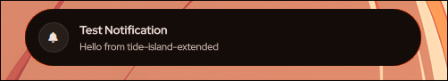
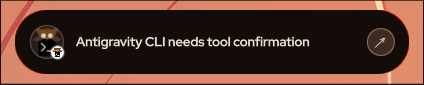
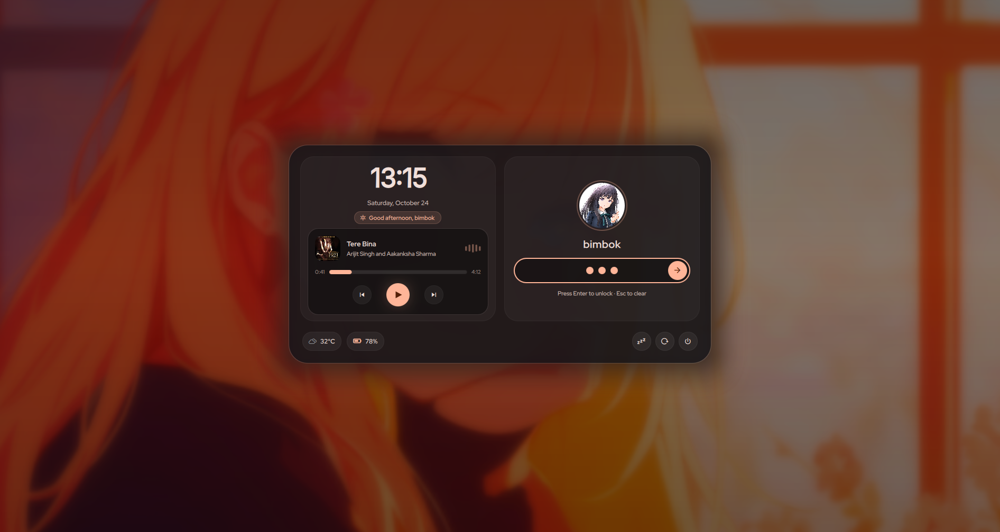
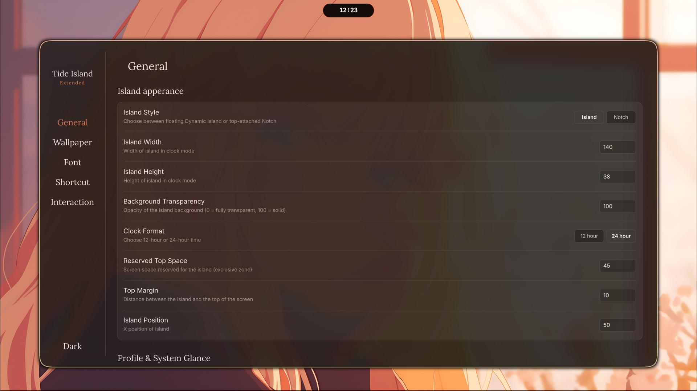

<h1 align="center">Tide Island Extended</h1>

<p align="center">
  <b>An independently maintained and enhanced fork of Tide Island for Hyprland and niri.</b>
</p>

<p align="center">
  <a href="https://github.com/Bimbok/Tide-island-extended/stargazers"></a>
  <a href="https://github.com/Bimbok/Tide-island-extended/issues"></a>
  <a href="https://github.com/enhaoswen/Tide-island"></a>
  
  
  
</p>

<p align="center">
  <b>Upstream:</b> <a href="https://github.com/enhaoswen/Tide-island">enhaoswen/Tide-island</a>
</p>


<p align="center">
  <a href="#preview">Preview</a>
  ·
  <a href="#features">Features</a>
  ·
  <a href="#installation">Installation</a>
  ·
  <a href="#configuration">Configuration</a>
  ·
  <a href="#common-commands">Common Commands</a>
  ·
  <a href="#acknowledgments">Acknowledgments</a>
</p>

---

## About Tide Island Extended

Tide Island Extended is a desktop widget for Hyprland and niri, styled like the Dynamic Island.

When nothing much is going on, it sits compactly in your bar or corner, staying out of the way. When you need to check information, it expands into an interactive panel where you can view lyrics, switch workspaces, adjust system settings, check notifications, view weather, or inspect custom system statistics.

It is built with Quickshell, QML, and C++/Qt 6. Animations are tuned to be fluid and responsive while keeping resource usage minimal.

> [!NOTE]
> ### About This Project
>
> **Tide Island Extended** is an independently maintained and enhanced fork of [Tide Island](https://github.com/enhaoswen/Tide-island), originally created by [**@enhaoswen**](https://github.com/enhaoswen).
>
> The original Tide Island project provided the core architecture, animation system, Dynamic Island concept, and foundation on which this project is built.
>
> **Tide Island Extended has its own development direction and codebase.** It is not intended to remain in direct sync with upstream. Selected ideas, features, fixes, or improvements from the original project may be incorporated when they are considered meaningful and suitable for this project, adapted and integrated into the codebase as needed.
>
> Beyond these upstream-inspired improvements, Tide Island Extended also introduces its own features, integrations, performance improvements, UI refinements, and other enhancements.


<br>

## Preview

### Dynamic Island Capsules

<p align="center">
  
</p>

<table>
  <tr>
    <td width="33%" align="center">
      
    </td>
    <td width="33%" align="center">
      
    </td>
    <td width="33%" align="center">
      
    </td>
  </tr>
</table>

### Native Dynamic Island Lockscreen

<p align="center">
  
</p>

### Interactive Panels

<table>
  <tr>
    <td width="50%">
      
    </td>
    <td width="50%">
      
    </td>
  </tr>
  <tr>
    <td width="50%">
      
    </td>
    <td width="50%">
      
    </td>
  </tr>
  <tr>
    <td width="50%">
      
    </td>
    <td width="50%">
      
    </td>
  </tr>
  <tr>
    <td width="50%">
      
    </td>
    <td width="50%">
      
    </td>
  </tr>
  <tr>
    <td width="50%">
      
    </td>
    <td width="50%">
      
    </td>
  </tr>
  <tr>
    <td width="50%">
      
    </td>
    <td width="50%">
      
    </td>
  </tr>
</table>

### Config App

<p align="center">
  
</p>
<br>

## Features

### Extended Enhancements

- **MacBook Top Notch & Dynamic Island Style Switcher**:
  - **Fluid Dual-Style Morphing**: Freely toggle between the classic floating **Dynamic Island** (floating pill capsule with customizable top margin) and top-attached **MacBook-Style Notch** (flush with the top bezel at `y: 0`, flat 0px top corners, 16px bottom rounded corners, and smooth 10px concave transition ears curving naturally into the screen bezel).
  - **Full Workspace & Panel Harmony**: Seamlessly applied across resting island states, expanded panels, notifications, and the workspace overview switcher.
  - **In-App Toggle & Direct Shortcut**: Switch on the fly via the **Island Style** selector in **Tide Island Extended Settings** (`[ Island ]` / `[ Notch ]`), pressing `SUPER+ALT+N`, or via Quickshell IPC.
- **Bluetooth Earphone & Headset Satellite Bubble**:
  - **Instant Connection Pop-Out**: A sleek satellite circular bubble automatically emerges alongside the island whenever Bluetooth earphones, headphones, or audio headsets connect.
  - **Live Circular Battery Gauge**: Circular progress ring framing the centered device icon that smoothly depletes and dynamically shifts color based on battery level (`batteryHigh`, `batteryMedium`, `batteryLow` from your active Matugen theme).
  - **Zero Clutter**: Automatically dismisses smoothly when the device disconnects.
- **Redesigned Control Center 2×2 Drawer Grid**: Symmetrical 2-column drawer layout featuring:
  - **Row 1**: Battery power profile selector + quick Silent and Night mode toggles.
  - **Row 2**: Sleek modern **System Tray** + compact **Screen Recorder** companion card side-by-side.
- **Sleek Horizontal Scrolling System Tray (SNI)**: Embedded StatusNotifierItem tray widget with item count badge pill, smooth horizontal flick/wheel scrolling, 34×34 squircle icon tiles, edge fade gradient masks when overflowed, tooltips on hover, and full click/context menu interaction.
- **Native GPU Screen Recorder & Instant Replay**: Dedicated screen recorder powered by `gpu-screen-recorder` with full Matugen color harmony:
  - **Pull-Down Drawer Card**: Half-width companion card providing instant Record/Stop, mic audio capture toggle, and quick recordings folder access.
  - **Dynamic Active Elevation**: When recording or when the instant replay buffer is active, a full-featured recorder banner automatically elevates into the main Control Center view with live timer, pause/resume, mic toggle, and instant clip saving (10s, 30s, 60s) without needing to open the drawer.
  - **Dynamic Island Status**: Real-time pulsing indicator dot directly in the island clock capsule.
  - **Bidirectional Sync**: Seamless PID and state tracking with external terminal scripts (`gsr`).
- **Dynamic Color Palette & Matugen Integration**: Live hot-reloads of `colors.json` on disk via `QFileSystemWatcher` without service restarts. Ready-to-use Matugen template with preserved capsule translucency (`islandBackgroundOpacity`).
- **Dynamic Battery Color Progression**: Battery pill smoothly shifts colors based on charge level (critical, warning, nominal, charging) with full Matugen color matching and an on/off toggle in settings.
- **Marquee Track Title Scrolling**: Clean, smooth auto-scrolling for long song titles with an initial 1.8s reading pause and seamless looping, plus an instant toggle in the Config App to fall back to static ellipsis (`Title...`) for 0% CPU.
- **Universal Keyboard Navigation & Dismissal**: Universal `Escape` key dismissal and keyboard navigation across all interactive panels (Control Center, Notification Center, File Shelf, Calendar, and Power Menu).
- **Asynchronous Clipboard & Concurrency Safety**: Fast asynchronous decoding for image clipboard entries and race-condition guards during clip deletions.
- **Interactive Control Center Sliders & Quick Corner Actions**:
  - **Microphone Intensity Slider**: Native input gain slider powered by WirePlumber (`@DEFAULT_AUDIO_SOURCE@`) with 40ms event throttling, fluid drags, and instant click-to-mute corner toggle.
  - **Click-to-Mute Sound Card**: One-click corner icon toggle for system audio (`@DEFAULT_AUDIO_SINK@`) with dynamic mute icon (`󰝟`), `"Sound (Muted)"` title indicator, and dimmed accent fill.
  - **Dynamic Sun Glyph & Brightness Presets**: Real-time morphing sun icon matching backlight level (`󰃞` <30%, `󰃟` 30%–70%, `󰃠` >70%) plus click-to-cycle presets (`10% ➔ 30% ➔ 65% ➔ 100% ➔ 10%...`).
- **Audio Device Switcher Flyout (Outputs & Inputs)**: Side flyout panel opened with one click on the chevron (`›`) on either the Sound or Microphone card:
  - **Output Devices**: Instantly switch default audio sink/port between Speakers, Headphones, Bluetooth earbuds, and HDMI with visual active indicator checkmarks.
  - **Input Devices**: Instantly switch active microphone source between Internal Mic, USB Mic, and Headsets.
  - **Sleek Tab Switcher**: Segmented pills (`[ Output | Input | Mixer ]`) allow seamless navigation between output devices, microphones, and per-app streams in place.
- **Per-App Volume Mixer**: Integrated PipeWire/WirePlumber application volume mixer:
  - Displays all active applications playing audio (Firefox, Spotify, Discord, Steam, games).
  - High-res desktop app icons resolved automatically via the freedesktop icon theme.
  - Compact individual volume sliders and one-click app mute toggles.
- **Battery Health, Charge Limit & Conservation Mode**: Direct hardware control for laptop battery lifespan preservation:
  - **Lenovo IdeaPad Conservation Mode**: Hardware-level 80% charge threshold integration via `ideapad_acpi` (`conservation_mode`), capping charge at 80% while plugged in to prevent battery wear.
  - **Generic Laptop Charge End Threshold**: Automatic support for standard Linux battery threshold interfaces (`charge_control_end_threshold`) with preset pills (`80%`, `85%`, `90%`, `100%`).
  - **Dedicated Battery Flyout Panel**: Symmetrical 318×404 flyout opened by clicking the battery pill in the Control Center header or the chevron (`›`) on the drawer Battery card.
  - **Live Battery Telemetry**: Real-time display of battery charge status, health percentage (`batteryHealthPercent`), cycle count (`batteryCycleCount`), and an active `80% Cap` badge.
  - **Zero-Latency Non-Blocking Control**: Asynchronous C++ backend paired with automated `systemd-tmpfiles` permissions (`tide-island-battery.conf`) for instantaneous toggling without root password prompts or UI freezes.
- **Symmetrical Flyout Architecture & Mutual Exclusivity**:
  - All side panels (Wi-Fi, Bluetooth, Audio, Battery) share identical 318×404 geometry and unified typography.
  - Clean mutual exclusivity automatically dismisses active sibling panels when a new flyout is opened, eliminating clutter.
- **Dedicated Microphone & Audio Dynamic Island OSD Feedback**: Real-time PipeWire audio source/sink monitoring (`pactl subscribe`) that keeps sliders in sync and triggers matching Dynamic Island pills (`[   XX%  ◯ ]` and `[ 󰝟  XX%  ◯ ]`) whenever adjusted via hotkeys, CLI commands, or UI clicks.
- **Throttled Slider Performance**: Event throttling on microphone, volume, and brightness slider drags to eliminate IPC and D-Bus lag, maintaining smooth 60fps+ responsiveness.
- **Unified Icon Weight Harmony**: Clean, consistent icon line weights across volume, microphone, brightness, battery, and weather.
- **Optimized State Management**: In-place reactive property updates for custom info layers, eliminating unnecessary delegate re-instantiations and flickers.
- **Privacy & Media Activity Indicators & HUD**:
  - **Dynamic Island Activity Bubbles**: Independent circular satellite bubbles dynamically pop out on the right side of the island capsule when the camera (``) or microphone (`` / ``) are active, matching the File Shelf bubble aesthetic with pulsing status badges (green for camera, orange for active microphone, red when muted).
  - **Privacy & Media Activity HUD**: Interactive drop-down panel displaying applications currently capturing camera, microphone, or screen sharing with PID telemetry, quick one-click app mute/unmute or screen share stop controls, and a master hardware microphone mute toggle.
  - **Modal Dismissal & Focus**: Closes seamlessly via `Escape` key and click-outside dismissal, maintaining consistent focus behavior across Wayland compositors.
  - **Full Theme Harmony**: Automatically styled using `StyleTokens` to inherit Pywal, Matugen, or custom theme palettes.
- **On-Demand System Glance Capsule & Dashboard**:
  - **Dynamic Island Mini Dashboard**: The island expands into a system glance dashboard displaying a circular avatar / profile picture (with auto-detection from ChillPill-Shell `displayPicture`, `userconfig.json` `"avatarPath"`, image drag-and-drop, or click-to-browse), hostname, system uptime, rich multi-metric battery telemetry (`⚡ 71% • 80% Cap • 100% Health` with power wattage and full diagnostics tooltip), real-time network throughput (`↓ 5.2 MB/s`, `↑ 240 KB/s`), CPU load & core temperature, RAM utilization (`GB` and `%`), and GPU / Storage meters.
  - **Kernel & Scheduler Telemetry Pill**: The bottom capsule displays live kernel release and CPU architecture (e.g. `Linux 7.2.7-1-cachyos-bore (x86_64)`), active CPU scaling governor (`powersave`), 1m/5m/15m system load averages (`Load: 1.25, 0.90, 0.84`), and live running/total scheduling task entities.
  - **100% On-Demand Sampling**: Sampling timers only run when the glance layer is visibly mounted; zero CPU overhead when hidden. No third-party monitor dependencies (e.g. `nusmon`), extracting metrics directly from standard Linux `/proc` and `/sys` interfaces.
  - **Intuitive Triggers & Controls**: Sleek modern aesthetic without intrusive close buttons — dismiss seamlessly with `Escape`, click outside, or shortcut toggle (`SUPER+G`).
- **In-App Matugen Assistant**: Direct one-click template installation and TOML snippet copying right inside Tide Island Settings (`Color & Wallpaper` tab).
- **Native Dynamic Island Lockscreen & Ambient Multi-Monitor Standby**:
  - **Fluid In/Out Morphing Animations**: An authentic, buttery-smooth Wayland lockscreen (`tide-island --lock`, `tide-island-lock`, or `quickshell ipc call lock lock`) that enters with a dynamic zoom-blur morph directly from the resting dynamic island capsule and smoothly lifts, dissolves, and unblurs upon unlocking.
  - **Embedded Hero Music Player**:
    - High-resolution album cover art in a rounded squircle frame.
    - **Live Audio Visualizer**: 5-bar live equalizer syncing in real time with Cava audio frequency telemetry or procedural audio waveforms when music is playing.
    - **Mac / Control Center Pill Capsule Scrubber**: Seekable capsule progress bar that smoothly thickens from 8px to 14px on hover or drag with zero distracting knobs or dots.
    - **Hero Playback Controls & Track Timestamps**: Balanced Previous, glowing Hero Play/Pause button with warm ambient accent halo, Next track controls, and live elapsed / total duration counters (`1:14 / 4:05`) with instant click-and-drag seek.
  - **Linux PAM Authentication & Security**: Complete, secure Linux PAM authentication with responsive typing micro-interactions, Enter-to-unlock, `Esc`/`Ctrl+U` to clear, error shake animation on failed attempts, system lockout detection (`faillock`) with live countdown timers, and automatic session restoration.
  - **Cute Password Pearls**: Frosted glass pill input field featuring enlarged 14px glowing pearl bullets with bouncy pop spring animations (`Easing.OutBack`) that dynamically compact for longer passwords, keeping bullets centered and visible.
  - **Bundled Modern Typography**: Includes `InterVariable.ttf` out of the box for crisp, ultra-clean clock numbers, greeting pills, and system details with zero external font setup required.
  - **Dual-Panel Primary Card & Multi-Monitor Support**:
    - **Left Panel (Hero Clock, Date, Greeting & Media)**: Modern display clock, formatted date, dynamic contextual greeting pill (`Good afternoon, <user>`), and the embedded hero media player.
    - **Right Panel (Avatar & Authentication)**: Crisp circular user profile avatar with a living, breathing ambient halo glow, bold username, and the interactive password pill.
    - **Multi-Monitor Standby View**: Secondary and non-primary displays automatically show a minimalist ambient clock and date over the blurred wallpaper.
  - **Live Hardware Telemetry & Cute Soft Power Controls**:
    - Horizontal rounded battery pill (`\uf240`–`\uf244`) matching the Control Center and System Glance, with live charge percentage, charging bolt (`⚡`), and charge-aware color transitions.
    - Real-time weather condition pill with temperature.
    - Soft rounded glass power buttons (`Sleep`, `Restart`, `Power Off`) with hover glow and safe arming confirmation.
  - **Wallpaper Detection & In-App Customization**:
    - Automatic live wallpaper extraction from `awww`, `swww`, or `hyprpaper` with real-time Gaussian blur and saturation preservation.
    - Dedicated lockscreen settings in **Tide Island Settings** (`General` ➔ `Lockscreen`) with toggles for Wallpaper Blur, Lockscreen Media Player, Power Action buttons, Battery Status pill, and custom wallpaper file selection.

### Core Features

- Clock
- Dynamic Island Lockscreen & Ambient Multi-Monitor Standby (`tide-island --lock`, desktop shortcut, or IPC)
- Dynamic Island & MacBook Top Notch styles (Super + Alt + N, Settings, or IPC)
- System Glance & Dashboard (Super + G, swipe down, or IPC)
- Bluetooth earphone connection bubble with dynamic battery gauge ring
- Music player
- Control Center
- Audio device switcher & per-app volume mixer
- Microphone control & mute toggle
- Battery health & charge limit (conservation mode)
- Timer
- Lyrics displayer
- Application launcher
- File shelf
- Clipboard history manager
- Weather & Forecast
- Calendar
- Wallpaper switcher
- Workspace overview
- Custom page
- Notification Center
- Power menu
- System Tray (SNI)
- Screen Recorder & Instant Replay

Clipboard history requires `cliphist` and `wl-clipboard`. Tide Island starts the clipboard watcher automatically while it is running.
Click a date in the calendar to write a note. Dates with notes show a small dot; notes are saved automatically.
Click the × button on a notification card to dismiss it, or use **Clear All** in the Notification Center to dismiss all notifications at once.


### System Feedback

- Volume & audio mute changes
- Microphone intensity & mute changes
- Brightness changes
- Battery charging / discharging & conservation limit
- Workspace changes
- Media playback (optional)
- System notifications


### Custom Page

- Time
- Date
- Battery
- Volume
- CPU usage
- Current workspace
- Memory usage
- Brightness
- Cava
- Storage usage
- Weather

### Compositor support

- Hyprland: full current experience, including Tide's workspace overview, workspace animations, shortcuts, and Night Light through `hyprsunset`.
- niri: island views, focused-output IPC commands, workspace change hints, native niri overview, shortcuts through `~/.config/tide-island/niri-shortcuts.kdl`, and Night Light through `gammastep`.
- Tide checks `TIDE_ISLAND_COMPOSITOR` first, then `$XDG_CURRENT_DESKTOP`. It uses `$NIRI_SOCKET` only when the desktop environment is inconclusive, then falls back to Hyprland. This prevents inherited compositor sockets from causing a false detection.

<br>

## Installation

### From Source (All Distributions)

Clone the repository and run the automated installer:

```bash
git clone https://github.com/Bimbok/Tide-island-extended.git
cd Tide-island-extended
./install.sh
```

The installer builds Tide Island, writes it to `/usr`, registers desktop and service files, and automatically handles dependencies on:

- **Arch Linux, EndeavourOS, Manjaro, CachyOS** (using `pacman`)
- **Debian, Ubuntu, Linux Mint, Pop!_OS** (using `apt`)
- **Fedora, RHEL, Nobara** (using `dnf`)
- **openSUSE** (using `zypper`)

> [!TIP]
> If you previously installed the older AUR `tide-island` package, remove it before running the installer:
> ```bash
> sudo pacman -R tide-island
> ./install.sh
> ```

For other distributions, install dependencies manually and run:

```bash
./install.sh --skip-deps
```

Quickshell is used from `/usr/bin/quickshell` when available. Otherwise the installer builds the pinned, verified Quickshell version compatible with this release. Qt 6.6 or newer is required.

Useful installer options:

| Option | Description |
| --- | --- |
| `./install.sh --no-service` | Install Tide Island without enabling or starting the systemd user service. |
| `./install.sh --skip-quickshell` | Skip building Quickshell from source and use existing `/usr/bin/quickshell`. |
| `./install.sh --force-build-quickshell` | Rebuild and install the project's pinned Quickshell version even if Quickshell is already installed. |
| `./install.sh --uninstall` | Remove the Tide Island files installed by the source installer. |

### Updating

To update Tide Island Extended to the latest version:

```bash
cd Tide-island-extended
git pull
./install.sh
```

<br>

## Starting Tide Island

Tide Island provides a systemd user service.

Enable and start it immediately (Recommended):

```bash
systemctl --user enable --now tide-island.service
```

If you want to manage startup manually, add this to your `hyprland.conf`:

```conf
exec-once = tide-island
```

Or add this to `hyprland.lua`:

```lua
hl.exec_once("tide-island")
```

If the systemd service is already enabled, you do not need to add `exec-once`.

<br>

## Configuration

Search `Tide Island Settings` in any application launcher, or run:

```bash
tide-island-config-app
```

- **Shortcuts**: Configure shortcuts for Workspace Overview, Application Launcher, Music Player, Notification Center, Control Center, System Glance (`Super + G`), Clipboard History (`Super + V`), Weather (`Super + E`), and Calendar (`Super + K` by default).
- **Interaction**: Configure click actions for the dynamic island pill (Left, Middle, and Right mouse buttons for Player, Control Center, and Clipboard History).
- **Weather**: Configure auto-detection or custom city name, temperature units (°C or °F), and refresh interval.
- **Calendar**: Quick month view with week numbers and relative date indicators. Click the date in the Control Center, press `Super + K`, or use the scroll wheel / arrow keys to browse months. Press `Home` to return to today, and `Esc` to close.
- **Screen Recorder & Instant Replay**:
  - Pull down the Control Center drawer to quickly start/stop recordings, toggle microphone capture, or browse saved clips.
  - While recording or buffering replay, the active recording card automatically elevates into the main Control Center view with a live timer and quick-save presets (60s, 30s, 10s).
  - All button highlights and glowing border accents harmoniously blend with your wallpaper's palette via Matugen.
- **System Tray (SNI)**:
  - Tucked inside the Control Center drawer with an item count pill badge and smooth horizontal wheel/touch scrolling.
  - Supports left-click activate, right-click context menus, wheel scrolling, and tooltip previews on hover.
- **Battery Health & Charge Limit (Conservation Mode)**:
  - Protect laptop battery longevity when connected to AC power. On supported hardware (such as Lenovo IdeaPads with `ideapad_acpi` or generic laptops supporting `charge_control_end_threshold`), toggle between **80% Conservation** mode and **100% Full Charge** directly in the dedicated Battery flyout panel.
  - Open the panel anytime by clicking the battery indicator pill in the Control Center header or clicking `›` on the drawer's Battery card.
  - The installer automatically configures `/usr/lib/tmpfiles.d/tide-island-battery.conf`, enabling instantaneous, passwordless switching without root prompts.
- **Audio Device Switcher & Application Mixer**:
  - Click the `›` chevron on either the Sound or Microphone card in the Control Center to reveal the Audio flyout panel.
  - Instantly switch default output endpoints (Speakers, Headphones, HDMI, Bluetooth earbuds) and active microphone sources in real time.
  - Switch to the **Mixer** tab to adjust individual per-application volume sliders and toggle mute status, complete with freedesktop application icons.
- **Lockscreen Settings**:
  - Set a custom lockscreen wallpaper path (with file picker and live preview), or automatically use the active desktop wallpaper (`awww`, `swww`, `hyprpaper`).
  - Responsive toggle switches for Wallpaper Blur, Lockscreen Media Player, Power Action pills, and Battery Status pill.
  - Customize the hero lockscreen clock font via `Time Font Family` in **Font Settings** or enjoy the bundled `Inter Variable` typography out of the box.
  - Configurable PAM service authentication backend (default: `login`, or `system-auth` / `hyprlock`).
  - Searchable application launcher entry: Launch "Lock Screen" directly from any app launcher via `tide-island-lock.desktop`.
- **Color Palette & Matugen**: Tide Island supports dynamic system-wide color palettes generated by tools like [Matugen](https://github.com/InioX/matugen) or customized manually in `~/.config/tide-island/colors.json`.
  - **Live Auto-Reload**: Palette updates on disk are automatically detected and reloaded instantly via `QFileSystemWatcher` without restarting the service.
  - **Transparency Preserved**: Island capsule background transparency (`islandBackgroundOpacity`) continues to work seamlessly alongside dynamic palette tints.
  - **In-App Template Installer**: Install the template directly to `~/.config/matugen/templates/` and copy configuration snippets with one click in **Tide Island Settings** under the Color & Wallpaper tab.
  - **Matugen Template**: A template is provided in `templates/tide-island-colors.json`. Add this to your `~/.config/matugen/config.toml`:
    ```toml
    [templates.tide_island]
    input_path = '~/.config/matugen/templates/tide-island-colors.json'
    output_path = '~/.config/tide-island/colors.json'
    ```


## Common Commands

#### Lock the screen:

```bash
tide-island --lock
# or: tide-island-lock
```

**Hyprland Keybinding (`hyprland.conf`)**:
```conf
bind = SUPER, L, exec, tide-island-lock
```

**niri Keybinding (`config.kdl`)**:
```kdl
binds {
    Mod+L { spawn "tide-island-lock"; }
}
```

**Idle Daemon Integration (`hypridle.conf`)**:
```conf
listener {
    timeout = 300                                 # 5min
    on-timeout = tide-island-lock                 # lock screen when timeout has passed
}

listener {
    timeout = 330                                 # 5.5min
    on-timeout = hyprctl dispatch dpms off        # screen off when timeout has passed
    on-resume = hyprctl dispatch dpms on          # screen on when activity is detected
}
```

#### Restart after editing the configuration:

```bash
systemctl --user restart tide-island
```

#### Stop Tide Island:

```bash
systemctl --user stop tide-island
```

#### View logs:

```bash
journalctl --user -u tide-island -f
```

#### IPC Commands

You can control Tide Island remotely using `quickshell ipc call`:

| Command | Action |
| --- | --- |
| `quickshell ipc call tide togglePlayer` | Open or close music player |
| `quickshell ipc call tide toggleControlCenter` | Open or close control center |
| `quickshell ipc call tide togglePowerMenu` | Open or close power menu |
| `quickshell ipc call tide toggleFileShelf` | Open or close file shelf |
| `quickshell ipc call tide toggleWallpaperPicker` | Open or close wallpaper switcher |
| `quickshell ipc call tide toggleApplicationLauncher` | Open or close application launcher |
| `quickshell ipc call tide toggleCalendar` | Open or close calendar view |
| `quickshell ipc call tide openCalendar` | Open calendar view |
| `quickshell ipc call tide closeCalendar` | Close calendar view |
| `quickshell ipc call tide toggleWeather` | Open or close weather view |
| `quickshell ipc call tide openWeather` | Open weather view |
| `quickshell ipc call tide closeWeather` | Close weather view |
| `quickshell ipc call weather refresh` | Refresh weather data immediately |
| `quickshell ipc call tide toggleClipboard` | Open or close clipboard history |
| `quickshell ipc call tide openClipboard` | Open clipboard history |
| `quickshell ipc call tide closeClipboard` | Close clipboard history |
| `quickshell ipc call tide toggleNotificationCenter` | Open or close notification center |
| `quickshell ipc call tide openNotificationCenter` | Open notification center |
| `quickshell ipc call tide closeNotificationCenter` | Close notification center |
| `quickshell ipc call tide togglePrivacy` | Open or close Privacy & Media Activity HUD |
| `quickshell ipc call tide openPrivacy` | Open Privacy & Media Activity HUD |
| `quickshell ipc call tide closePrivacy` | Close Privacy & Media Activity HUD |
| `quickshell ipc call privacy toggle` | Open or close Privacy & Media Activity HUD |
| `quickshell ipc call privacy show` | Open Privacy & Media Activity HUD |
| `quickshell ipc call privacy close` | Close Privacy & Media Activity HUD |
| `quickshell ipc call island toggle` | Toggle dynamic island capsules |
| `quickshell ipc call island show` | Show dynamic island capsules |
| `quickshell ipc call island hide` | Hide dynamic island capsules |
| `quickshell ipc call island toggleStyle` | Toggle between Dynamic Island and Top Notch styles |
| `quickshell ipc call island setStyle [island\|notch]` | Set island style explicitly to `island` or `notch` |
| `quickshell ipc call tide toggleStyle` | Toggle between Dynamic Island and Top Notch styles |
| `quickshell ipc call tide setStyle [island\|notch]` | Set island style explicitly to `island` or `notch` |
| `quickshell ipc call recorder toggle` | Start or stop screen recording |
| `quickshell ipc call recorder start` | Start screen recording |
| `quickshell ipc call recorder stop` | Stop screen recording |
| `quickshell ipc call recorder toggleMic` | Toggle microphone audio capture |
| `quickshell ipc call recorder pause` | Pause or resume active recording |
| `quickshell ipc call recorder toggleReplay` | Start or stop instant replay buffer |
| `quickshell ipc call recorder saveReplay [sec]` | Save replay clip (e.g. 10, 30, 60 seconds) |
| `quickshell ipc call recorder openRecordings` | Open recordings folder in file manager |
| `quickshell ipc call recorder openReplays` | Open saved replays folder in file manager |
| `quickshell ipc call tide reloadColors` | Reload color palette from colors.json |
| `quickshell ipc call theme reload` | Reload color palette from colors.json |
| `quickshell ipc call lock lock` | Lock the screen immediately |
| `quickshell ipc call lock unlock` | Unlock the screen |
| `quickshell ipc call lock toggle` | Toggle lockscreen state |

<br>

## Contributing

Issues, bug reports, design suggestions, and pull requests are all welcome.

-  only 1 topic per issue.
-  tell your ideas first before making a PR

## Acknowledgments

Heartfelt thanks and appreciation to:

- **[@enhaoswen](https://github.com/enhaoswen)**: The original creator and core architect of Tide Island, who built the remarkable foundation, animation engine, and vision for this Wayland dynamic island.
- **[@end-4](https://github.com/end-4)** for the workspace overview design inspiration
- **[@gozhuimeng](https://github.com/gozhuimeng)** for improving the lyrics backend
- **[@LatifKovani](https://github.com/LatifKovani)** for a significant improvement

---

<p align="center">
  <sub>
    A practical, beautiful, and highly customizable desktop experience for Wayland.
  </sub>
</p>
