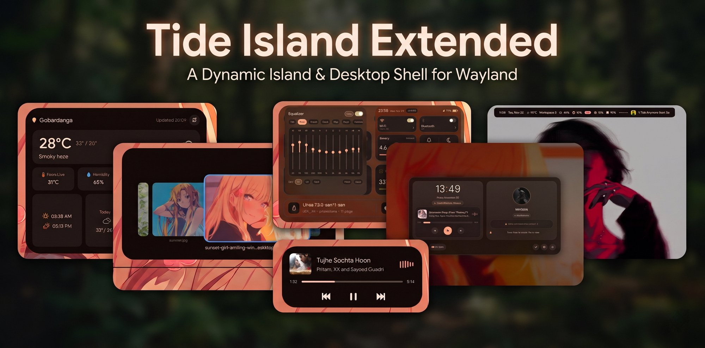
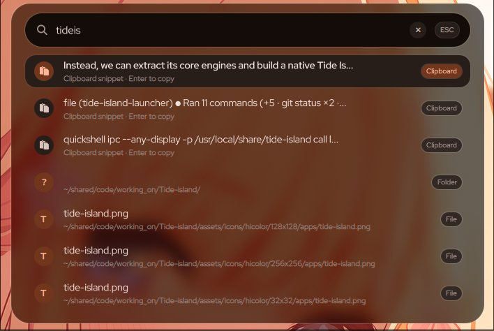
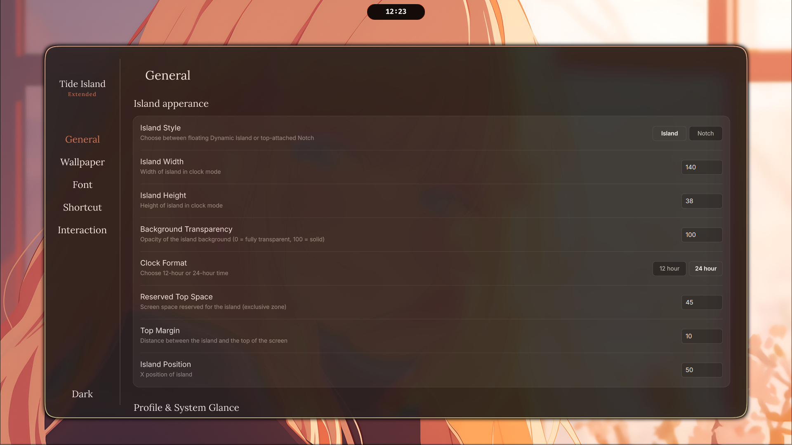

<p align="center">
  
</p>

<p align="center">
  <a href="https://github.com/Bimbok/Tide-island-extended/actions/workflows/ci.yml"></a>
  <a href="https://github.com/Bimbok/Tide-island-extended/stargazers"></a>
  <a href="https://github.com/Bimbok/Tide-island-extended/issues"></a>
  <a href="https://github.com/enhaoswen/Tide-island"></a>
  
  
  
</p>

<p align="center">
  <a href="https://trendshift.io/repositories/361921?utm_source=trendshift-badge&amp;utm_medium=badge&amp;utm_campaign=badge-trendshift-361921" target="_blank" rel="noopener noreferrer"></a>
</p>

<p align="center">
  <a href="#visual-showcase">Showcase</a>
  ·
  <a href="#highlights">Highlights</a>
  ·
  <a href="#performance">Performance</a>
  ·
  <a href="#quick-start">Quick Start</a>
  ·
  <a href="https://github.com/Bimbok/Tide-island-extended/wiki">Wiki & Docs</a>
  ·
  <a href="#acknowledgments">Credits</a>
</p>

---

## About

**Tide Island Extended** is a desktop shell widget and control suite for modern Wayland compositors (**Hyprland** and **niri**), inspired by the Dynamic Island concept.

When idle, it rests as a minimalist capsule pill or flush MacBook-style notch. When interacted with, it fluidly morphs into a full desktop control suite: unified Spotlight search, multi-device audio routing, 10-band DSP equalizer, hardware screen recording, live lyrics, hardware telemetry, battery health controls, and a native Wayland lockscreen.

Built with **Quickshell**, **QML**, and **C++/Qt 6**, all animations are hardware-accelerated at 60 FPS while maintaining an ultra-light resource footprint.

> [!NOTE]
> **Tide Island Extended** is an independently developed and maintained fork of [Tide Island](https://github.com/enhaoswen/Tide-island) by [**@enhaoswen**](https://github.com/enhaoswen).

---

## Visual Showcase

### Dynamic Island & MacBook Top Notch Capsules
<p align="center">
  
</p>

<table>
  <tr>
    <td width="33%" align="center">
      
    </td>
    <td width="33%" align="center">
      
    </td>
    <td width="33%" align="center">
      
    </td>
  </tr>
</table>

### Unified Spotlight Search
<p align="center">
  
</p>

### Native Dynamic Island Lockscreen
<p align="center">
  
</p>

### Interactive Panels & Flyouts
<table>
  <tr>
    <td width="50%"></td>
    <td width="50%"></td>
  </tr>
  <tr>
    <td width="50%"></td>
    <td width="50%"></td>
  </tr>
  <tr>
    <td width="50%"></td>
    <td width="50%"></td>
  </tr>
  <tr>
    <td width="50%"></td>
    <td width="50%"></td>
  </tr>
  <tr>
    <td width="50%"></td>
    <td width="50%"></td>
  </tr>
</table>

### Settings & Theming App
<p align="center">
  
</p>

---

## Highlights

* **Fluid Dual-Style Morphing**: Seamlessly switch between the floating **Dynamic Island** (capsule pill with customizable top margin) and top-attached **MacBook-Style Notch** (flush with top bezel at `y: 0`, 0px top corners, smooth rounded bottom corners) with `Super + Alt + N` or via settings.
* **Unified Spotlight Search**: macOS-style Spotlight modal (`Super + Space`) featuring live desktop application search, inline clipboard history search (`clip <query>`), hand-parsed math evaluation and unit conversions without `eval()`, direct web URL launching, dedicated battery profile hero card, and local file lookup.
* **Native 10-Band DSP Equalizer**: Dedicated low-latency C++ audio daemon (`tide-equalizer`) with 10 peaking biquad filters, 8 curated presets, stereo balance, and zero-resource on-demand lifecycle (0% CPU, 0 MB RAM when disabled).
* **Multi-Device Simultaneous Output ("Multi-Audio")**: Play audio across multiple physical outputs (e.g. Speakers + Bluetooth earbuds + USB DAC) at the same time with independent device sliders and automatic PipeWire combined-sink orchestration.
* **Native GPU Screen Recorder & Instant Replay**: Dedicated screen recorder powered by `gpu-screen-recorder` with zero-overhead `pidfd` monitoring, mic capture, and 10s/30s/60s instant replay clipping.
* **Battery Profile & Conservation Mode**: 3-mode power profile selector (Power Saver, Balanced, Performance) shared across Control Center and Spotlight, alongside laptop battery conservation threshold control (80%).
* **System Glance & Mini Dashboard**: On-demand system dashboard (`Super + G`) displaying live CPU/RAM/GPU telemetry, disk capacity, network throughput, Linux kernel/scheduler stats, and multi-distro package update checks.
* **Native Wayland Lockscreen**: Authentic Wayland lockscreen (`tide-island-lock`) with zoom-blur morphing, hero media player, live audio visualizer, PAM security, lockout detection, and multi-monitor ambient standby.
* **Dynamic Palette Theming**: Live hot-reloading Matugen and Pywal color palettes from `colors.json` without daemon restarts.

---

## Performance

| Metric | Measured Value | Architecture Details |
|---|---|---|
| **Idle CPU Usage** | **~0.1% – 0.5%** | Measured over 24+ hours daemon uptime; event-driven kernel sleep with zero timer polling |
| **Unique Process RAM** | **~50 – 65 MB** | Private anonymous heap/object memory unique to Tide Island |
| **On-Demand Daemons** | **0 MB idle** | Equalizer (`tide-equalizer`) and lyrics daemons terminate completely when inactive |
| **Lazy Layer Loading** | **0 MB when closed** | Spotlight, Control Center, and flyouts destroy instances when hidden |
| **Media & Telemetry** | **0 D-Bus polling** | Dead-reckoning MPRIS extrapolation and on-demand `/proc` telemetry sampling |

---

## Quick Start

### Arch Linux (Binary Package)
```bash
curl -LO https://github.com/Bimbok/Tide-island-extended/releases/latest/download/tide-island-extended-x86_64.pkg.tar.zst
sudo pacman -U tide-island-extended-x86_64.pkg.tar.zst
```

### From Source (All Distributions)
```bash
git clone https://github.com/Bimbok/Tide-island-extended.git
cd Tide-island-extended
./install.sh
```

### Start Daemon
```bash
systemctl --user enable --now tide-island.service
```

Launch settings anytime with:
```bash
tide-island-config-app
```

---

## Documentation & Wiki

For detailed guides, compositor keybindings, layer rules, IPC specifications, and troubleshooting, visit the **[GitHub Wiki](https://github.com/Bimbok/Tide-island-extended/wiki)**:

| Guide | Description |
|---|---|
| **[Installation Guide](https://github.com/Bimbok/Tide-island-extended/wiki/Installation-Guide)** | Package installation, manual CMake compilation, multi-distro dependencies, and NixOS modules. |
| **[Compositor Integration](https://github.com/Bimbok/Tide-island-extended/wiki/Compositor-Integration)** | Complete setup, keybindings, layer rules, and `hypridle` configurations for Hyprland and niri. |
| **[Island Modes & Features](https://github.com/Bimbok/Tide-island-extended/wiki/Island-Modes-&-Features)** | Deep dive into Dynamic Island vs Top Notch, Spotlight, Multi-Audio, Screen Recording, and Battery Profiles. |
| **[Audio Equalizer Daemon](https://github.com/Bimbok/Tide-island-extended/wiki/Audio-Equalizer-Daemon)** | Architecture, PipeWire filter-chains, real-time SIMD DSP FrameRing, and socket IPC of `tide-equalizer`. |
| **[Configuration & Theming](https://github.com/Bimbok/Tide-island-extended/wiki/Configuration-&-Theming)** | Configuration app usage, `config.json` schema, and live hot-reloading Matugen palettes. |
| **[IPC & CLI Reference](https://github.com/Bimbok/Tide-island-extended/wiki/IPC-&-CLI-Reference)** | Exhaustive list of `quickshell ipc call` commands, desktop binaries, and scripting hooks. |
| **[Troubleshooting & FAQ](https://github.com/Bimbok/Tide-island-extended/wiki/Troubleshooting-&-FAQ)** | Common questions, permissions, audio routing solutions, log inspections, and debugging. |

---

## Acknowledgments

Heartfelt thanks and appreciation to:
* **[@enhaoswen](https://github.com/enhaoswen)**: Original creator and core architect of Tide Island, who built the remarkable foundation, animation engine, and vision for this Wayland dynamic island.
* **[@end-4](https://github.com/end-4)** for workspace overview inspiration.
* **[@gozhuimeng](https://github.com/gozhuimeng)** for lyrics backend improvements.
* **[@LatifKovani](https://github.com/LatifKovani)** for code contributions and refinements.
* **[@LUCKYS1NGHH](https://github.com/LUCKYS1NGHH)** for reference and inspiration from [ChillPill-Shell](https://github.com/LUCKYS1NGHH/ChillPill-Shell).
* **[@marcho78](https://github.com/marcho78)** for inspiration and search, math evaluation, and frecency algorithms from [o-spotlight](https://github.com/marcho78/o-spotlight).

---

<p align="center">
  <sub>
    A practical, beautiful, and highly customizable desktop experience for Wayland.
  </sub>
</p>
